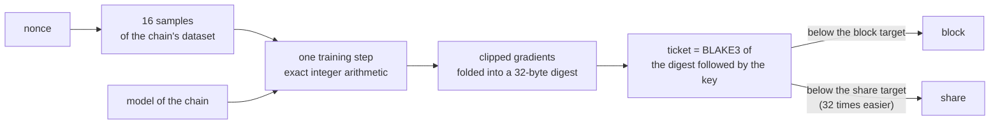
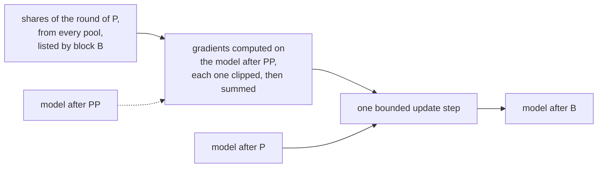

# neb-miner-metal

A mainnet NEB miner for the Apple M1 Max GPU, based on [SilasEigen/neb v1.0.9](https://github.com/SilasEigen/neb/tree/v1.0.9). It connects to the NEB node work service and mines both KEP1 slots, Kepler and TESS. The node and the miner use the upstream C implementation to verify candidate shares.

## M1 Max performance

On a 32-core M1 Max GPU with 64 GB of unified memory, the miner completed **57.79 billion tickets in one uninterrupted 30-minute Suprnova session** on November 26, 2026. Rates below count fully evaluated tickets. A nonce that the GPU screens out contributes zero to the rate.

| Model | Offline exhaustive | Offline selective | Live selective | Time on live jobs | Pool shares accepted / submitted |
| --- | ---: | ---: | ---: | ---: | ---: |
| Kepler | 1.37 M tickets/s | 24.75 M tickets/s | 23.22 M tickets/s | 26m 12s | 59 / 59 |
| TESS | 1.44 M tickets/s | 138.62 M tickets/s | 93.30 M tickets/s | 3m 48s | 19 / 20 |

The offline columns are medians over 24 timed blocks on two fixed, trained models with prepared tables. Live rates divide completed tickets by the time the pool assigned to each slot, including model changes and table setup. The combined live rate was **32.11 M tickets/s**. All 79 submissions received replies. The pool rejected one TESS share as stale when it announced a new Kepler job. The session finished on one TLS connection with zero verifier mismatches, CPU fallbacks or reconnects.

**What improved throughput.** Each gain below was confirmed against the preceding implementation on fresh work, with the two slots weighted equally. The percentages describe separate experiments.

| Change | Confirmed throughput gain (90% interval) |
| --- | ---: |
| Use 256 threads per nonce, exact 16-bit vector arithmetic and precomputed sums for zero gradients | +34.1% (+32.5% to +35.8%) |
| Overlap Rust sample preparation with GPU execution using eight in-flight Metal commands | +24.0% (+22.5% to +25.6%) |
| Generate samples for four keys at once in Rust and shorten Metal dot products to the nonzero rows | +55.5% (+53.5% to +57.6%) |

Selective mining adds the largest gain on sparse models. The GPU computes exact tickets from cached digests for zero, one or two nonzero sample gradients. It builds the pair table in slices so mining can continue during setup. Reusing valid pairs across Kepler model changes cut median setup from **3.79 s to 3.05 s** in 12 paired trials. The miner can choose exhaustive scanning when the expected gain would take too long to repay setup. [Tuning measurements and replay commands](docs/metal-pool-tuning.md)

On the original fixed genesis jobs, the first Metal release ran **2.04× as fast on Kepler and 2.01× on TESS** as the optimized 10-thread CPU miner. All 16,384 tickets matched the CPU reference byte for byte. [CPU comparison and methodology](docs/metal-benchmark.md)

## Build and run on macOS

Install a stable arm64 Rust toolchain and the Xcode Command Line Tools. From the repository root:

```sh
cargo build --manifest-path node/Cargo.toml --release --locked -p neb-gpuminer --features metal --bin neb-miner-metal
mkdir -p build
curl --fail --location --output build/neb-datasets.bin https://github.com/SilasEigen/neb/releases/download/v1.0.9/neb-datasets.bin
node/target/release/neb-miner-metal --dataset build/neb-datasets.bin --benchmark
```

The miner checks the release dataset's BLAKE3 hash at startup. The benchmark runs offline. To mine with a synced node configured with your mining lock, use:

```sh
node/target/release/neb-miner-metal --dataset build/neb-datasets.bin --node 127.0.0.1:3441
```

### Test a real Suprnova TLS share

For a timed session with a named worker, reconnect handling, local event logs and the adaptive GPU screen, see [M1 Max pool operation and measured optimizations](docs/metal-pool-tuning.md).

Save your own public NEB payout address on one line in `.neb-payout-address` at the repository root. Git ignores this file. Set `POOL_URL` to your Suprnova NEB TLS endpoint, then run:

```sh
python3 tools/test_metal_stratum.py --pool "$POOL_URL"
```

The Python 3 adapter connects with certificate and hostname verification, starts the release Metal executable on a temporary loopback work service, and submits its CPU-checked candidate under your payout login. It requests a fixed difficulty of one million attempts per share, subject to the pool's limits. The test exits after the first pool acceptance or a 120-second timeout and shuts down the child. An acceptance confirms submitted work. Account credit and payout follow the pool's accounting rules. [Suprnova's NEB Stratum specification](https://neb.suprnova.cc/CoinInfos.html#stratum)

### How the Metal engine works

The host builds upstream's per-sample gradient table when a slot's weights change. In exhaustive mode, Rust selects the samples and each 256-thread Metal group reduces their gradients to an eight-lane digest. Rust hashes the digest and checks the target. In selective pool mode, the GPU selects the samples, looks up the digest for eligible combinations, hashes the ticket and checks the target. Both paths send candidate shares to the CPU reference for verification.

The work-service client rechecks every candidate with the CPU reference before submitting it, probes each new model and audits ongoing scans. A failed parity check switches the affected slot to the reference scanner. The executable prints attempts/s, submitted shares, accepted blocks, mismatches and fallbacks.

### Reproduce the local node test

This test uses the same local payout address file. It starts an isolated NEB node on loopback with easier difficulty and proof verification enabled, then checks that the node accepts at least three blocks, includes shares, and credits each block's miner output to the specified lock. These blocks belong to the isolated test chain.

```sh
NEB_MAINNET_DATASET="$PWD/build/neb-datasets.bin" cargo test --manifest-path node/Cargo.toml --locked --release -p neb-gpuminer --features metal --test metal_node -- --ignored --nocapture
```

The [M1 Max benchmark](docs/metal-benchmark.md) records the workload and results. Related work includes [upstream PR #2](https://github.com/SilasEigen/neb/pull/2), an independent Metal implementation, and [Suprminer's model-specific GPU benchmarks](https://github.com/ocminer/suprminer/releases/tag/v1.9.60).

## Upstream NEB

NEB (Neural Engine Byte) is a proof-of-work cryptocurrency where mining trains a neural network. Every mining attempt is one training step of a small network that the chain owns, computed in exact integer arithmetic. The chain trains two small convolutional networks with 4-bit weights on public scientific data, one block each in turn, both on exoplanet searches: transit signals of the Kepler mission (NASA Exoplanet Archive), sorted into planet candidates and false positives, and signals found in the light curves of the TESS mission (Astronet-Triage-v2), sorted into eclipses and junk. A node checks a block by running its attempts again, about 2 ms of one CPU core per attempt, with no zero-knowledge proof and no trusted party.

[Whitepaper](docs/whitepaper.md) | [Specification](spec/shares.md) | [Node and chain](spec/node.md) | [Main network](docs/mainnet.md) | [Node guide](docs/testnet.md) | [Docker](docs/docker.md) | [Mining engines](docs/mining.md) | [Experiments](docs/experiments.md)

## NEB at a glance

**One mining attempt**



**How the model evolves, one block later**



NEB's innovation lies in the protocol-level integration of deterministic neural network training with proof of work: the training step is the mining proof, and the shares that nodes validate train a model that the chain owns.

- **Nothing to choose.** The chain fixes the dataset and the model; the miner chooses only the nonce.
- **Training without extra work.** Shares come from the same attempts as blocks.
- **Verification by replay.** Every node rebuilds the model from the shares listed in the blocks. There is no proof system to trust.
- **Bounded influence.** Clipping and a bounded residual limit what one share can do to one step (Theorem 1 of the whitepaper).

| | |
|---|---|
| Network | 784-128-10, 4-bit weights, 101,632 weights |
| One attempt | 16 samples, one training step, about 3.3 million integer multiply-accumulates |
| Shares | about 32 per block, applied one block later |
| Block time | 60 s target, ASERT (aserti3-2d) with a 600 s half-life |
| Supply | 20 NEB per block, halving every 450,000 blocks; 5% project share in the coinbase. The genesis block also pays the carry-over of the test networks, a tenth of each balance ([docs/carry-over.md](docs/carry-over.md)) |
| Money layer | UTXO, Ed25519 signatures, BLAKE3, no virtual machine |
| Verification | about 0.5 ms of one CPU core per attempt, 17 ms for a typical block |

In simulation of the protocol, the Kepler model reaches 88.8% on stars it never trained on (a float network of the same shape trained with Adam: 89.0%), and the retina model 55% on four balanced classes after 12,000 blocks. The models of the main network are small convolutional networks ([spec/nebhash-v2.md](spec/nebhash-v2.md)): in simulation, 90.8% for Kepler and about 95% for TESS after 3,000 blocks, on 1,860 test signals of which 86.6% are junk, with 9 eclipses in 10 found. The test network trained the same kind of network on retinal scans, normal or abnormal: 81 to 83% in simulation (500 balanced test scans). Earlier measurements on MNIST: 96.0% test accuracy in simulation, and on the node software 10 pools train the model as well as one (89.9% after 300 blocks).

## Status

Version 1.0.9 runs the main network: protocol 3, two models from the first block, parameters in [docs/mainnet.md](docs/mainnet.md). Its genesis block pays each lock a tenth of the balance it held on each of the two test networks, on the same wallet file ([docs/carry-over.md](docs/carry-over.md)). By default a node dials the public relays of the network (port 3440) and then learns other addresses from its peers; `--no-seeds` keeps it alone, and `--connect` and `--seed` choose other peers.

The test network of protocol 3 stays in the software for trials of upgrades: `neb-node --run --testnet`, with the dataset file of release 0.3.1 ([docs/testnet.md](docs/testnet.md)). Its coins have no value.

## Quick start

### From a release

Download from the release page the archive for your system, `neb-datasets.bin` (the two datasets, 16 MB, pinned by hash) and `SHA256SUMS`, and check them as described in "Releases". On Windows, in PowerShell:

```powershell
Expand-Archive neb-1.0.9-windows-x86_64.zip neb; Move-Item neb-datasets.bin neb; cd neb
.\neb-wallet.exe --wallet wallet.txt new         # asks for a password, prints your address; keep a copy of wallet.txt and of the password
$lock = .\neb-wallet.exe --wallet wallet.txt lock
.\neb-node.exe --run --dataset neb-datasets.bin --datadir data --miner-lock $lock
```

In a second window:

```powershell
.\neb-miner-cpu.exe --node 127.0.0.1:3441 --dataset neb-datasets.bin    # or neb-miner-gpu.exe on an NVIDIA GPU
.\neb-wallet.exe --rpc http://127.0.0.1:8432 --wallet wallet.txt balance
```

On Linux:

```bash
mkdir neb && tar -xzf neb-1.0.9-linux-x86_64.tar.gz -C neb && mv neb-datasets.bin neb && cd neb
./neb-wallet --wallet wallet.txt new
./neb-node --run --dataset neb-datasets.bin --datadir data --miner-lock "$(./neb-wallet --wallet wallet.txt lock)" &
./neb-miner-cpu --node 127.0.0.1:3441 --dataset neb-datasets.bin    # or neb-miner-gpu
```

Mined coins are spendable after 100 blocks. The GPU miner needs an NVIDIA GPU of compute capability 7.5 or later and a driver for CUDA 13 (580 or later).

### With Docker

```bash
export NEB_MINER_ADDRESS=neb1...      # the address printed by neb-wallet new
docker compose up -d
docker compose logs -f node miner
```

The images hold no key, only the address that receives the rewards. GPU and relay setups: [docs/docker.md](docs/docker.md).

### From source

Requirements: Rust, a C compiler, and Python 3 with numpy for the dataset tool.

```bash
git clone https://github.com/SilasEigen/neb.git && cd neb
(cd node && cargo build --release --locked)                 # neb-node, neb-wallet, neb-miner-cpu
python tools/make_datasets.py --cache ../neb-cache --out ../neb-testnet-datasets.bin   # the four datasets of the test network
python -I tools/make_mainnet_datasets.py ../neb-testnet-datasets.bin --tess ../neb-tess --out ../neb-datasets.bin   # needs astropy and the two files of the TESS record; or take neb-datasets.bin from the release
node/target/release/neb-node --dataset-hash ../neb-datasets.bin # 790b57fbd830f3dcbe7de9d1146aa89a0a20799118e30dd48a343a5c98f19e72
```

`cargo build --release --locked -p neb-gpuminer --features cuda` adds `neb-miner-gpu` (CUDA toolkit 13). The miners can also use optional AVX-512 and tensor-core engines, off by default and checked against the reference: see [docs/mining.md](docs/mining.md). Node options, ports and wallet commands are in [docs/testnet.md](docs/testnet.md).

## Documentation

| Document | Contents |
|---|---|
| [docs/whitepaper.md](docs/whitepaper.md) | Design, security model and main results |
| [spec/shares.md](spec/shares.md) | Normative: the attempt, the ticket, shares and the model step |
| [spec/node.md](spec/node.md) | Normative: blocks, transactions, chain rules, work service, P2P, JSON-RPC |
| [docs/mainnet.md](docs/mainnet.md) | Parameters of the main network, its genesis block and what differs from the test network |
| [docs/carry-over.md](docs/carry-over.md) | The tenth of the test network balances paid in the genesis block, and how to rebuild the lists |
| [docs/testnet.md](docs/testnet.md) | Running a node, a relay, the miners and the wallet; parameters of the test network |
| [docs/mining.md](docs/mining.md) | Optional mining engines and their safeguards |
| [docs/experiments.md](docs/experiments.md) | Simulations, measurements, validation and throughput, with methods |
| [CONTRIBUTING.md](CONTRIBUTING.md) | Repository layout, checks to run and contribution rules |

## Releases

Release archives contain `neb-node`, `neb-wallet`, `neb-miner-cpu` and `neb-miner-gpu`. Each release has a `SHA256SUMS` file signed with the release key (`SHA256SUMS.asc`) and a detached signature for each archive (`.sig`). The public key is the release asset `release-key.asc`, fingerprint `EBF3 A9A0 37BC D121 0464  2A30 D7FC 5241 9E25 BBC4`.

```bash
gpg --import release-key.asc
gpg --verify SHA256SUMS.asc SHA256SUMS
sha256sum -c SHA256SUMS
```

On Windows, in PowerShell, compare these hashes with the lines of `SHA256SUMS` (Gpg4win verifies the signature):

```powershell
Get-FileHash -Algorithm SHA256 neb-1.0.9-windows-x86_64.zip, neb-datasets.bin
```

Changes are listed in [CHANGELOG.md](CHANGELOG.md).

## License

Apache-2.0, see [LICENSE](LICENSE). Security reports: [SECURITY.md](SECURITY.md).
