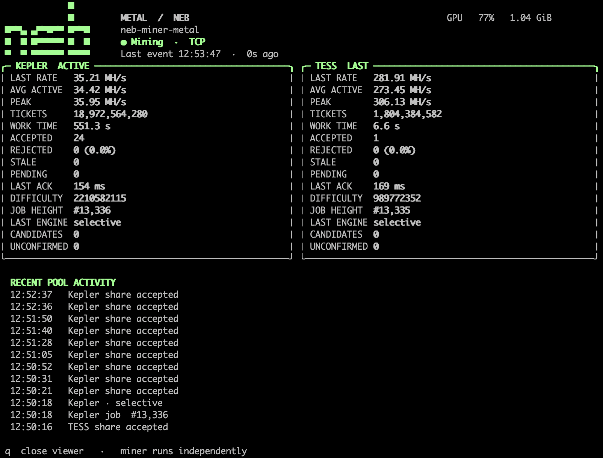

# neb-miner-metal

Mine NEB on an Apple silicon Mac using Metal. The GPU mines both NEB models, Kepler and TESS, and reuses calculations in the Mac's unified memory. Before submitting a share, the miner checks it against NEB's CPU reference. The terminal dashboard shows each model's hashrate, accepted shares and stale shares separately.

## M1 Max scan speed

On a 32-core M1 Max with 64 GB of unified memory, neb-miner-metal scanned **146.7× as fast on Kepler** and **135.6× as fast on TESS** as `pramonoutomo/neb-metalminer` once each model was loaded. Both miners produced the same 8,192 tickets per model on identical jobs. The table shows median exhaustive scan rates over five passes.

| Model | neb-miner-metal | pramonoutomo/neb-metalminer |
| --- | ---: | ---: |
| Kepler | 695,146 tickets/s | 4,737 tickets/s |
| TESS | 676,496 tickets/s | 4,989 tickets/s |

Our miner builds a lookup table before scanning. That took 306 ms for Kepler and 164 ms for TESS. The other miner loaded each model in 0.003 ms and computed gradients during the scan. [Benchmark and replay commands](docs/metal-benchmark.md#matched-metal-scan-on-november-27-2026) · [Peer implementation](https://github.com/SilasEigen/neb/pull/2)

## Pool mining on M1 Max

In a 30-minute Suprnova pool run on the same Mac, Kepler averaged **23.22 MH/s** and TESS averaged **93.30 MH/s**. Each rate counts completed tickets over the time the pool assigned that model, including setup. Suprnova accepted 59 of 59 Kepler shares and 19 of 20 TESS shares. One TESS share went stale at a job change. [Pool tests and tuning](docs/metal-pool-tuning.md)



## Try it on your Mac

Install the Xcode Command Line Tools and a stable arm64 Rust toolchain. From the repository root, build the miner, download the pinned NEB dataset, and run the offline CPU and GPU benchmark.

```sh
cargo build --manifest-path node/Cargo.toml --release --locked -p neb-gpuminer --features metal --bin neb-miner-metal
mkdir -p build
curl --fail --location --output build/neb-datasets.bin https://github.com/SilasEigen/neb/releases/download/v1.0.9/neb-datasets.bin
node/target/release/neb-miner-metal --dataset build/neb-datasets.bin --benchmark
```

**Have an M2 Max, M3 Max, M4 Max or M5 Max?** Try the benchmark above and share your results. Include your chip, GPU core count, unified memory, macOS version, commit (`git rev-parse --short HEAD`) and the benchmark output for both slots. Slot 0 is Kepler and slot 1 is TESS. [Report a benchmark](https://github.com/jpaljasma/neb-miner-metal/issues/new)

## Mine with Suprnova

With Python 3 installed, save your NEB payout address in `.neb-payout-address` and your Suprnova TLS pool URL in `.neb-pool-url`, each on one line in the repository root. Git ignores both files. [Suprnova pool setup](https://neb.suprnova.cc/StartMining.html)

```sh
./start-neb.command
```

The launcher opens a 24-hour pool worker and its dashboard in separate Terminal windows. Press **q** to close the dashboard. Press **Control-C** in the worker window to stop mining.

Based on [SilasEigen/neb v1.0.9](https://github.com/SilasEigen/neb/tree/v1.0.9). [Apache-2.0 license](LICENSE)
